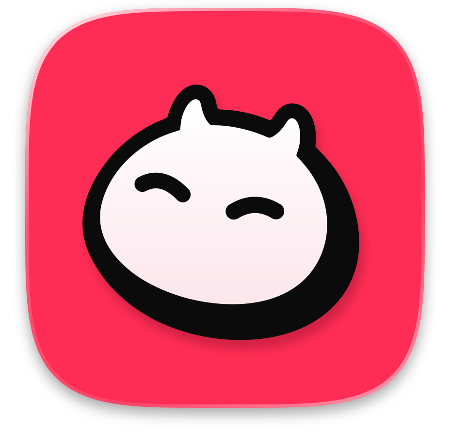
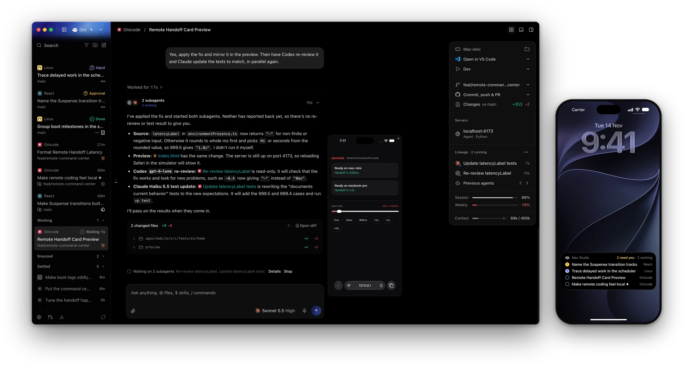
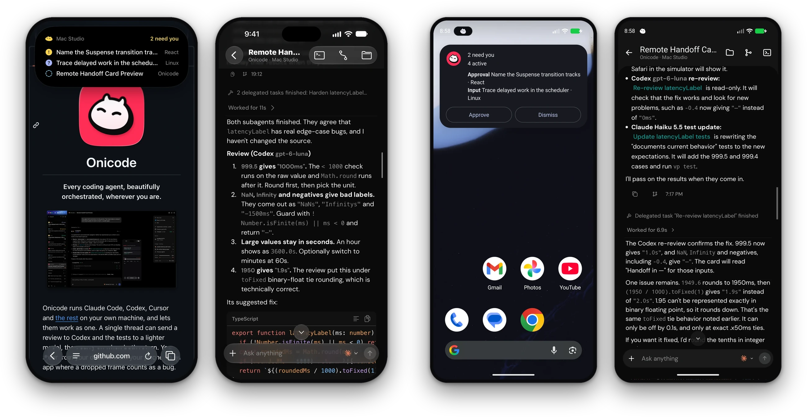

<h1 align="center"><br />Onicode</h1>

<p align="center"><b>Every coding agent, beautifully orchestrated, wherever you are.</b></p>

<p align="center">
  
</p>

Onicode runs Claude Code, Codex, Cursor and [the rest](./docs/user/install.md#providers) on your own machine, and lets them work as one. A single thread can send a review to Codex and the tests to a lighter model, then carry on when both return. You steer from your desk or from your phone, in an app where a dropped frame counts as a bug.

<p align="center">
  
</p>

Onicode is a fork of [T3 Code](https://github.com/pingdotgg/t3code). We still take in its fixes and features, one reviewed commit at a time, and part ways with it in a few places.

## What's different from T3 Code

- **Nothing in between.** No account, no relay, no telemetry. The apps speak to your machine directly, over your own network or Tailscale.
- **Your tailnet, no pairing code.** Choose a machine from your tailnet and you are in. A host can accept tailnet connections alone.
- **The whole screen.** When an agent's work needs a GUI, see and control that machine's desktop from another computer or your phone.
- **A phone that keeps watch.** It tells you when an agent needs approval, asks a question, finishes or fails, and the Lock Screen shows what is still running. Alerts pass through a gateway that stores nothing, and you can run your own.
- **Claude Code, in full.** Context usage, MCP servers, agents, skills, memory, hooks and permissions, all within reach on desktop and mobile.
- **Quicker throughout.** The desktop app opens sooner, a streaming agent no longer redraws the sidebar or finished messages, and folders are found through zoxide and fzf.

## From source

Install [Vite+](https://viteplus.dev/guide/) for the `vp` command, then:

```bash
git clone https://github.com/aislopware/onicode.git
cd onicode
vp i
vp run dev
```

See [Development](./docs/operations/development.md) for the rest.

---

[Docs](./docs) · [Contributing](./CONTRIBUTING.md) · [Security](./.github/SECURITY.md) · [MIT license](./LICENSE)
