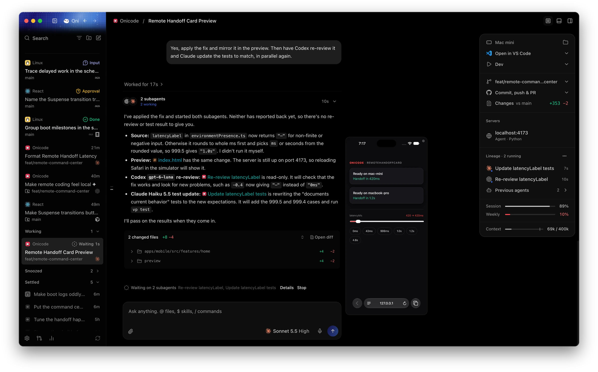

<p align="center">
  
</p>

<h1 align="center">Onicode</h1>

<p align="center">A desktop and mobile app for the coding agents you already pay for.</p>

<p align="center">
  
</p>

A server on your machine runs Claude Code, Codex, Cursor, Grok Build, OpenCode, Antigravity, Kiro, Pi, fx and other agent CLIs. The apps connect to it from the same machine, your local network or your tailnet.

Onicode is a fork of [T3 Code](https://github.com/pingdotgg/t3code). We keep porting its fixes and features, one reviewed commit at a time, and go our own way on the points below.

## What's different from T3 Code

- **No account, no relay, no telemetry.** The apps reach your machine directly, over your local network or Tailscale. You never sign up, and the apps send no analytics.
- **Tailscale sign-in.** Pick a machine from your tailnet and connect without a pairing code. A host can also accept tailnet connections only.
- **Remote desktop.** See and control a machine's whole screen from another desktop or your phone, for the moments an agent's work needs a GUI.
- **Phone notifications.** Your phone alerts you when an agent needs approval, asks a question, finishes or fails, and the Lock Screen shows the agents still running. Alerts pass through a push gateway that stores nothing, and you can deploy your own.
- **More of Claude Code.** Claude threads show what fills the context window, manage MCP servers, and open the session's agents, skills, memory, hooks and permissions, on desktop and mobile.
- **Speed.** The desktop app starts sooner, and the sidebar and finished messages stop re-rendering while an agent streams. Add project, the command palette and `@` mentions find folders through zoxide and fzf.

## From source

Install [Vite+](https://viteplus.dev/guide/) for the `vp` command, then:

```bash
git clone https://github.com/aislopware/onicode.git
cd onicode
vp i
vp run dev
```

See [Development](./docs/operations/development.md) for the rest.

---

[Docs](./docs) · [Contributing](./CONTRIBUTING.md) · [Security](./.github/SECURITY.md) · [MIT license](./LICENSE)
